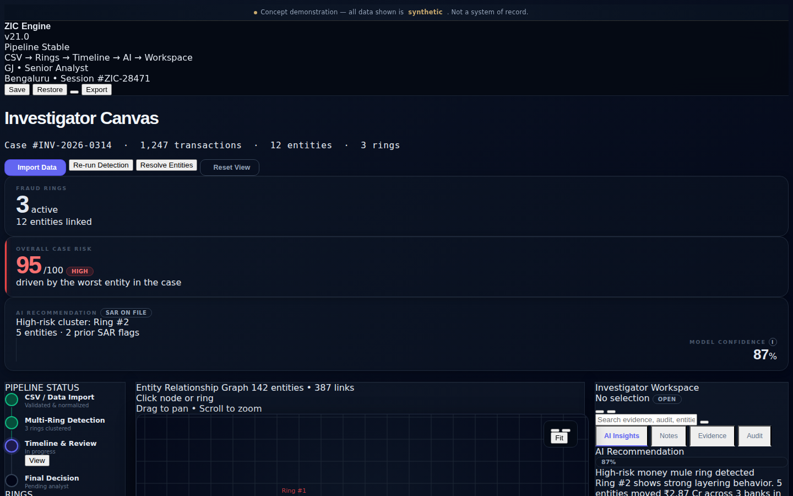

# Fraud Investigation Canvas

**Status:** v21.0 · Independent open-source project

**Documentation:** [LICENSE](./LICENSE)

Maintained by **Gururaj G J** — Senior Fraud Risk | Merchant Risk | Financial Crime Professional
[LinkedIn](https://www.linkedin.com/in/gururaj-gj-52a062b4/) · [GitHub](https://github.com/Gururaj-GJ-G)

> Note: this is a separate codebase from the [ZIC Decision Engine](https://github.com/Gururaj-GJ-G/zic-decision-engine) —
> same product family, distinct functions (human investigation console vs. automated decisioning).

---

## What it is

A single-screen, browser-based fraud investigation console designed to give an analyst
everything they need for a complex, multi-entity case without switching tools:

- Interactive entity-relationship graph with multi-ring detection and entity resolution
- An AI recommendation card summarizing likely next steps
- SHA-256 evidence hashing with a "Verify Integrity" action
- An append-only audit trail
- Global search across entities, evidence, audit log, and analyst notes
- Case save/export and compliance-ready report generation

## Screenshot

## Why this exists

Fraud-ring investigations typically span multiple accounts, devices, and transactions, and
analysts often stitch together evidence across spreadsheets, tickets, and ad-hoc notes. This
canvas puts entity relationships, evidence, and the audit trail in one workspace, with evidence
integrity that can be independently verified.

## Architecture

A self-contained single-page application. It runs on synthetic demonstration data by design —
this is an investigation *tool*, not a live production data feed, which is an appropriate and
transparent choice for a demo or evaluation context. It has zero external network calls; the
entire investigation workflow runs client-side.

## Use cases

Fraud and trust & safety teams evaluating investigator tooling for multi-entity ring detection,
evidence management, and audit-ready case documentation.

## License

MIT — see [LICENSE](./LICENSE).
